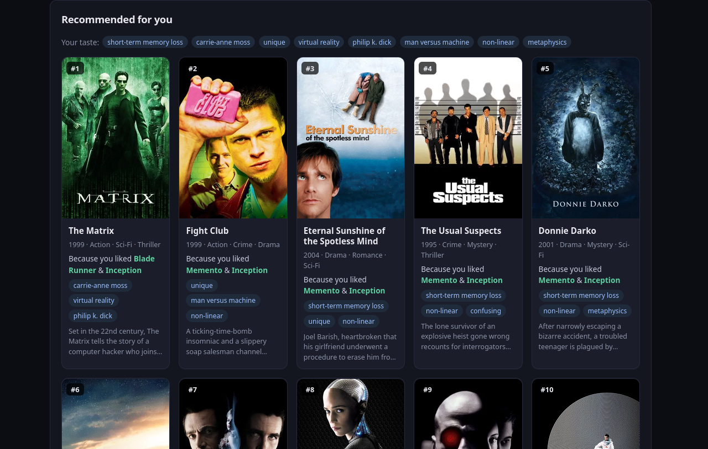
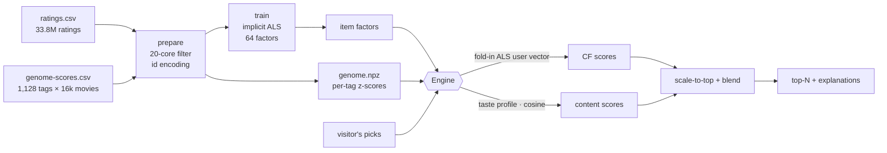

# Hybrid Movie Recommender

[](https://github.com/doodoobird189/recommender/actions/workflows/ci.yml)

[](https://docs.astral.sh/uv/)

[](https://doodoobird189-movie-recommender.hf.space)

A movie recommender that blends **collaborative filtering** (implicit-feedback ALS on 32M MovieLens
ratings) with a **content model** built on the MovieLens *Tag Genome*. Any visitor can pick a few
movies and get instant, explained recommendations. Their taste is folded into the model on the fly,
with no account and no retraining.

**▶ Try it live: [doodoobird189-movie-recommender.hf.space](https://doodoobird189-movie-recommender.hf.space)** (if it has been idle, give it a moment to wake up)



## Highlights

- **Works for brand-new users.** The ALS user step is solved in closed form at request time (a
  64×64 Cholesky solve, ~0.1 ms), so the web app needs no user database and no `implicit` at runtime.
- **Explains every recommendation.** ALS scores decompose *exactly* into per-movie contributions
  ([Hu et al. 2008](http://yifanhu.net/PUB/cf.pdf), §5), which drives the *"Because you liked
  Memento & Inception"* line. When the content model drives a pick, the explanation comes from
  genome similarity instead. Shared tags (*"non-linear"*, *"dystopia"*) come from the genome.
- **Evaluated honestly.** Baselines, a **temporal split**, a validation window for tuning, and
  beyond-accuracy metrics (coverage, novelty, diversity, cold-start recall). The evaluation code
  calls the same scoring functions as the web app.
- **Production-shaped.** `uv` project with a lockfile, `src/` layout, CLI, 40+ tests, ruff, GitHub
  Actions CI, multi-stage Docker image (non-root, healthcheck, gunicorn).

## Results

Temporal split: trained on every rating before **2020-08-28**, evaluated on what 5,000 users
actually watched *after* that date. This is how a deployed recommender is really used: predicting
the future from the past.

| Model | NDCG@10 | Recall@10 | Cold-start recall@20 | Catalogue coverage | Novelty |
|---|---:|---:|---:|---:|---:|
| Popularity (all-time) | 0.126 | 0.020 | 0.000 | 1.4% | 1.60 |
| Popularity (last 12 months) | 0.212 | 0.050 | 0.000 | 1.2% | 3.07 |
| Content only (tag genome) | 0.160 | 0.037 | **0.131** | 7.7% | **11.95** |
| ALS only | 0.207 | 0.040 | 0.000 | **9.6%** | 3.29 |
| **Hybrid (served, cf = 0.25)** | **0.230** | **0.052** | 0.017 | 8.6% | 4.34 |

Full tables, including a random split and every blend weight: [`reports/metrics.md`](reports/metrics.md).

### What I learned

1. **A trending-popularity baseline is nearly as good as ALS.** Under the temporal split,
   "most-rated in the last 12 months" matches ALS on NDCG and *beats* it on recall. Without that
   baseline, ALS looks far better than it is.
2. **The evaluation protocol decides the winner.** On a random split, CF-heavy models win (ALS 0.314,
   cf = 0.9 blend 0.317) and adding more content *hurts* (cf = 0.25: 0.216). Randomly held-out
   ratings reward memorising co-occurrence among popular films. On the temporal split, the hybrid beats ALS by **+11% NDCG and +29% recall**.
3. **Naive score blending silently fails.** My first hybrid z-scored both signals, and it never
   recommended a single cold movie (cold recall exactly 0.000). Diagnosis: ALS scores are
   heavy-tailed (top items at z ≈ 12) while genome cosine tops out at z ≈ 3.4, so ALS dominated
   every blend. Rescaling each signal so its *top-10 mean* = 1 fixed it.
4. **Accuracy trades off against diversity.** The content signal makes lists more on-theme
   (intra-list diversity 0.72 → 0.47). The slider in the app shows that trade-off directly.

The blend weight (cf = 0.25) was chosen by NDCG@10 on a **separate validation window**
(2018-07-10 → 2020-08-28), never on the test window.

## How it works



| Component | Idea |
|---|---|
| **Confidence** | `c = 1 + α·rating` (Hu et al.), so every watched movie is a positive with graded confidence |
| **ALS fold-in** | `x_u = (YᵀY + Yᵀ(Cᵤ−I)Y + λI)⁻¹ YᵀCᵤp(u)`, verified against `implicit`'s own solver in the tests |
| **Genome profile** | Tags z-scored across the catalogue, then `Σ (rating − 2.5) · genome(movie)`, so disliked movies push away |
| **Blend** | `w · scale(ALS) + (1 − w) · scale(content)`. Movies without genome data get a neutral content term |
| **Explanations** | Exact per-item ALS contribution `c_i · y_tᵀA⁻¹y_i`, or genome similarity for content-driven picks |

## Quickstart

Requires [uv](https://docs.astral.sh/uv/). Docker is optional.

```bash
make install          # uv sync: creates .venv with Python 3.12 + all deps
make download         # MovieLens ml-latest (~335 MB) -> data/ml-latest/
make pipeline         # prepare -> train -> evaluate (~11 min on 12 cores)
cp .env.example .env  # optional: add a free TMDB key for posters
make serve            # http://127.0.0.1:5000
```

Run `make help` for all targets. Without a TMDB key the app still works and shows title cards
instead of posters.

### Docker

```bash
make docker-pipeline  # optional: run the offline pipeline in a container (data/ is mounted)
make docker-build     # slim runtime image with artifacts baked in
make docker-run       # http://localhost:8000
```

The runtime image installs only the serving dependencies. Training libraries live in a separate
`train` dependency group and Docker target. The container honours `$PORT`, so it also deploys
as-is to Render, Fly.io, Railway or Cloud Run.

### Deploying (Hugging Face Spaces)

The live demo is a Docker Space built from the same Dockerfile. Trained artifacts are not in git,
so `make deploy` ([`scripts/deploy_space.py`](scripts/deploy_space.py)) stages the source, lockfile,
artifacts and reports, adds the Space config header, and uploads it all as one commit:

```bash
uvx --from huggingface_hub hf auth login   # token with write access to the Space
make deploy
```

The TMDB key is set as a Space **secret** (`TMDB_API_KEY`) and never leaves Hugging Face's settings.

## API

| Method | Path | Description |
|---|---|---|
| `POST` | `/api/recommend` | `{"liked": [movieId…]}` or `{"ratings": {movieId: 0.5–5}}`, optional `cf_weight` (0 = content … 1 = CF) and `n` |
| `GET` | `/api/search?q=` | Title search, popularity-ranked |
| `GET` | `/api/popular?n=&seed=` | Random draw from the 300 most-rated movies |
| `GET` | `/api/sample-user` | A real MovieLens user's ratings, for the demo |
| `GET` | `/api/model` | Model card + evaluation metrics |
| `GET` | `/healthz` | Liveness |

```bash
curl -s localhost:5000/api/recommend -H 'Content-Type: application/json' \
     -d '{"liked": [2571, 79132, 4226], "n": 5}' | jq '.recommendations[].title'
```

## Project layout

```
src/recommender/
├── cli.py          # `recommender prepare | train | evaluate | serve`
├── config.py       # paths (env-overridable) and hyperparameters
├── data.py         # loading, k-core filtering, encoding, random/temporal splits
├── genome.py       # tag-genome matrix + explanation-tag filtering
├── train.py        # ALS training (implicit)
├── scoring.py      # ALS fold-in, content scorer, blend, top-k: shared by eval & serving
├── evaluation.py   # metrics, baselines, weight selection, report tables
├── engine.py       # serving engine: recommend + explain
├── tmdb.py         # cached, concurrent TMDB client (optional)
└── web/            # Flask app factory, template, static JS/CSS
tests/              # unit + API tests on a synthetic catalogue (no dataset needed)
reports/            # committed evaluation results
```

## Caveats

- **Genome leakage.** The tag genome was computed by GroupLens in 2023 from all data, so in the
  temporal split it contains some information from after the cutoff. Real cold-start items would
  need content features available at release, such as plot embeddings from TMDB overviews.
- **Catalogue filter.** The 20-ratings filter runs on the full dataset, so the catalogue includes
  movies that are cold at the cutoff but become popular later. That's deliberate (it creates the
  cold-start test), but it means the catalogue itself "knows" those movies exist.
- **Relevance = watched.** Any held-out rating counts as relevant, including low ones. The task is
  "what will this user watch next", not "what will they rate highly".
- Metrics use 5,000 sampled users per split (fixed seed). The genome covers 70% of the catalogue.

## Ideas for next steps

- Learning-to-rank second stage (LightGBM LambdaRank over CF/content/recency/popularity features)
- TMDB plot embeddings for genuine day-zero cold start
- Recency-aware CF (time-decayed confidence), given how strong the recent-popularity baseline is
- Hyperparameter sweep for ALS (factors, λ, α) on the validation window

## License & acknowledgements

Code: [MIT](LICENSE). The MovieLens data is not included and is subject to GroupLens' own
non-commercial terms.

Data: [MovieLens](https://grouplens.org/datasets/movielens/) by GroupLens Research (F. M. Harper &
J. A. Konstan, 2015). Tag Genome: Vig, Sen & Riedl, 2012. Posters and overviews: [TMDB](https://www.themoviedb.org/).
This product uses the TMDB API but is not endorsed or certified by TMDB.
